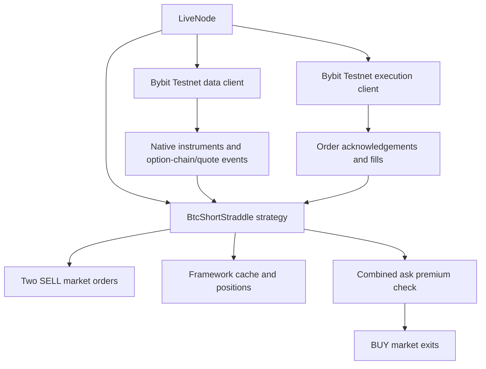

# BTC Options Straddle — Interview Study Guide

Use this guide to prepare a two-hour walkthrough. Read the code, trace the
events, then explain it out loud without reading the answers word for word.
The goal is to explain what you understand and be clear about what you have not
verified.

## Be transparent about the project status

The earlier version shared on GitHub was a read-only market-data and validation
milestone. The current local revision replaces that custom REST pipeline with a
NautilusTrader strategy and Bybit Testnet data and execution clients.

The local revision has **10 passing offline tests** and builds a node locally
with placeholder Testnet credentials. It has **not** connected to Bybit or
submitted orders. Bybit Testnet displayed error `10024` with a regulatory access
restriction when access was attempted, so no Testnet keys were created and no
execution result is claimed. Do not use a VPN, another person's account,
Mainnet, or Demo as a workaround. Ask Bybit Support whether access is permitted
for your account. The assignment explicitly accepts an incomplete implementation
when you can explain your effort and blocker.

The current refactor is on your local branch until pushed. If you show the
GitHub URL, make clear which version it contains.

## Two-hour plan

| Time | Focus | What to do |
|---|---|---|
| 0–10 min | Assignment | Explain Level 1 vs. Level 2, and which parts are implemented or unverified. |
| 10–25 min | Repository | Read `README.md`, `PROJECT_PROGRESS.md`, `config.py`, and `main.py`. Trace how the node is assembled. |
| 25–45 min | Instrument selection | Read `select_pair`, `on_start`, and `on_option_chain`. Explain nearest expiry, settlement, matching call/put, then ATM strike. |
| 45–65 min | Entry lifecycle | Read `_submit_entry`, `on_order_accepted`, and `on_order_filled`. Explain why an acknowledgement is not a fill. |
| 65–85 min | Risk and failures | Trace quote checks, premium calculation, stop/target, rejection, partial fill, and exit retry behavior. |
| 85–100 min | Restart and shutdown | Read `_recover_pair`, `on_start`, and `on_stop`. Explain reconciliation and best-effort flattening limits. |
| 100–110 min | Tests | Run `uv run pytest`; map each test to the behavior it proves. Do not describe these as exchange tests. |
| 110–120 min | Practice | Answer the ten assignment questions below in your own words and identify one thing you would improve. |

Take a short break between topics if needed. The goal is understanding, not
memorizing this document.

## The system in one picture

The design uses NautilusTrader for venue connectivity, instrument and market
data delivery, order creation, order and position state, and lifecycle. The
strategy keeps the rules specific to a BTC short straddle: ATM pair selection,
entry quantity, combined premium, and exit thresholds.

## Repository walkthrough

### `src/btc_options_straddle/config.py`

This file fixes both Bybit clients to `BybitEnvironment.TESTNET` and enables only
the options product. The API key and secret are read from Testnet-specific
environment variables by the adapter. Never substitute Mainnet credentials or
endpoints.

### `src/btc_options_straddle/main.py`

`build_node()` registers the Bybit data and execution factories with a
`LiveNode`, then registers `BtcShortStraddle`. `main()` calls `node.run()` and
disposes the node on exit.

**Running this entry point can submit Testnet orders.** Do not run it for a
walkthrough or offline check. Node construction with placeholder credentials
only proved local configuration and did not connect.

### `src/btc_options_straddle/strategy.py`

- `select_pair()` finds the soonest expiry with a call and put at a shared strike
  and settlement currency. It prepares the option series; it does not itself
  decide which strike is ATM.
- `on_start()` reads option instruments from the NautilusTrader cache, refuses
  duplicate entry if relevant orders or positions are already reconciled, and
  subscribes to an option-chain slice for that expiry.
- `on_option_chain()` takes the chain's ATM strike and resolves the matching
  call and put from the cached instruments, then subscribes to their quotes.
- `on_quote()` checks that both asks are present, recent, and synchronized. It
  initiates entry once both option quotes are usable. After entry, it compares
  the sum of the asks with the combined entry premium.
- `_submit_entry()` creates one SELL market order per leg. The legs are two
  separate orders, so the exchange can accept or fill one without the other.
- `on_order_accepted()` logs acknowledgement. `on_order_filled()` records the
  actual fill quantity and price. It calculates the entry premium only after
  both entry orders are terminal and the filled quantities match.
- Entry rejection, denial, cancellation, expiry, or unequal final fills cancel
  remaining strategy entry orders and trigger best-effort closing orders for
  any cached short positions.
- `exit_reason()` applies a 1% stop when the buyback premium rises from entry,
  and a 2% target when it falls. Exits are BUY market orders sized from cached
  short positions and marked reduce-only.
- A rejected, canceled, or expired exit is retried once. Another failure is
  logged as unresolved exposure and needs operator attention.
- `_recover_pair()` resumes monitoring if startup reconciliation finds exactly
  a matching short call/put pair with equal quantity. Unmatched positions or
  open option orders stop the strategy rather than starting a duplicate entry.
- `on_stop()` cancels tracked entry orders and makes a best-effort attempt to
  flatten short positions. It cannot guarantee an exit fill before shutdown.

## Lifecycle: explain it in order

1. The node registers the data and execution clients and connects to the
   configured Testnet endpoints when run.
2. The adapter loads option instruments into NautilusTrader's cache.
3. The execution engine's startup reconciliation aligns framework order and
   position state with the venue before the strategy decides whether to enter.
4. `on_start()` refuses to duplicate an open option order or position. With no
   existing exposure, it selects an expiry and subscribes to the option chain.
5. `on_option_chain()` receives the ATM strike, selects the matching call/put,
   and subscribes to both quotes.
6. `on_quote()` waits for two usable quotes. `_submit_entry()` submits two SELL
   orders. These submissions are not an atomic straddle.
7. Order events distinguish accepted, rejected, denied, canceled, and filled
   outcomes. Fills—not acknowledgements—determine the actual entry premium and
   open positions.
8. While running, fresh ask quotes drive the combined premium check. A trigger
   submits BUY orders for the open short positions.
9. On a normal stop, `on_stop()` cancels entry orders and requests exits. A
   crash, forced kill, or lost data connection may prevent this callback or
   stop the local trigger from running.
10. On restart, framework reconciliation restores venue state. The strategy
    resumes only a matched pair; unresolved orders or unmatched positions stop
    new entry and require review.

The stop and target are local strategy checks, not exchange-hosted protection.
Do not say the position is protected while the program is offline.

## Why the old validation machinery was removed

The earlier version used direct REST calls for instrument/ticker discovery and
order books, then built custom dataclasses, validators, VWAP calculations, and
a validation pipeline. Those tests were useful for that read-only milestone,
but they did not execute orders.

The refactor delegates instrument and quote delivery to the Bybit data client,
order routing to the execution client, and order/position state to NautilusTrader
cache and portfolio. The ATM pairing, quote freshness policy, combined premium,
and stop/target conditions remain custom because they are strategy rules.

## What the tests prove

The 10 tests use local objects and no Bybit connection. They cover pair
selection, premium thresholds, equal-quantity fill arithmetic, entry failure
response, a bounded exit retry, and matched-pair restart recovery. They do not
prove that Bybit accepts an order, that an order fills, or that a position is
closed at the venue.

The local node-build check used dummy credentials and asserted that the node
was not running. It did not connect to an exchange.

## Ten assignment questions to practice

1. **How does NautilusTrader start?** `main()` builds a `LiveNode`; the node
   registers adapters and the strategy, then `run()` starts the live lifecycle.
2. **How is Bybit configured?** Both clients explicitly use Testnet and the
   options product; credentials come from Testnet-only environment variables.
3. **How does market data arrive?** The adapter loads instruments and publishes
   typed chain and quote events through NautilusTrader's data engine.
4. **How is ATM selected?** The strategy selects an expiry, consumes the
   option-chain ATM strike, and pairs call/put instruments at that strike.
5. **How does the strategy receive data?** Through `on_option_chain()` and
   `on_quote()` after native subscriptions.
6. **How are orders submitted?** The strategy creates orders with its native
   order factory and calls `submit_order()`; the execution client routes them.
7. **Accepted vs. executed?** `OrderAccepted` is an acknowledgement. `OrderFilled`
   records execution quantity and price.
8. **How are positions tracked?** NautilusTrader updates its cache/portfolio
   from fills and venue position reports; the strategy queries that state.
9. **How do stop and target work?** Fresh ask quotes are summed and compared
   with actual entry premium; the thresholds trigger BUY market exits. This
   check is local and does not run offline.
10. **What if one leg fails?** Cancel remaining strategy entries, close filled
    short positions best-effort, retry an exit once, and surface unresolved
    exposure for operator action.

## How to describe AI use

You can say:

> “I used Codex as a research and coding assistant, which the assignment allows.
> I reviewed the official documentation, checked APIs against my installed
> NautilusTrader 2.0.0rc8 runtime, wrote offline tests, reviewed each change,
> and kept the Testnet execution limitation explicit. I can explain each part
> and distinguish local verification from exchange verification.”

Do not claim that AI-generated code was tested against Bybit when it was not.

## Connect it to your existing skills

- **Python:** strategy structure, callbacks, Decimal calculations, and tests.
- **Data validation:** quote presence, age/skew, equal fill quantities, and
  explicit handling of incomplete data.
- **SQL/PySpark/migration:** transferable habits for tracing records, validating
  state across systems, and reconciling source and destination data. Explain
  the analogy without claiming those tools were used in this strategy.
- **ML:** useful background in experimentation and measurement; no ML model is
  needed for this rules-based assignment.

## Official references

- [NautilusTrader Bybit integration](https://nautilustrader.io/docs/latest/integrations/bybit/)
- [NautilusTrader strategy lifecycle](https://nautilustrader.io/docs/latest/concepts/strategies/)
- [NautilusTrader live-node configuration](https://nautilustrader.io/docs/latest/how_to/configure_live_trading/)
- [NautilusTrader emulated orders](https://nautilustrader.io/docs/latest/concepts/orders/emulated/)
- [Official Bybit live examples](https://github.com/nautechsystems/nautilus_trader/tree/develop/examples/live/bybit)
- [Bybit options tutorial (Rust-only; use for lifecycle concepts, not as Python code)](https://github.com/nautechsystems/nautilus_trader/blob/develop/docs/tutorials/delta_neutral_options_bybit.md)
